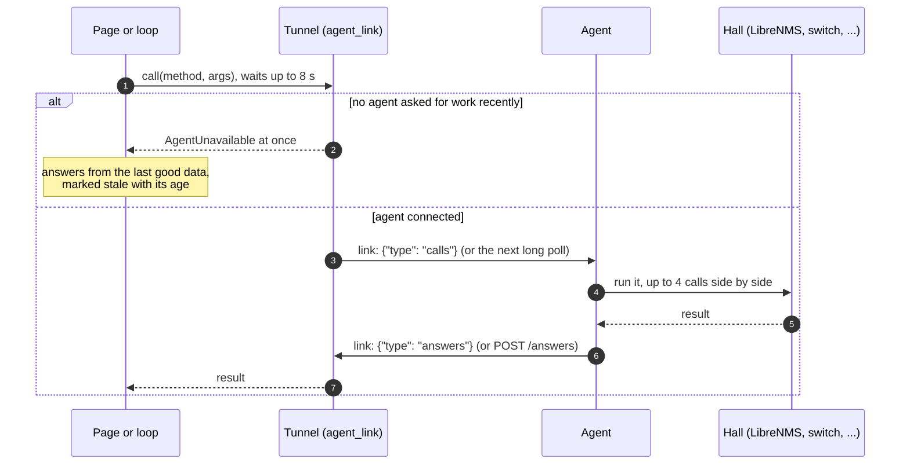
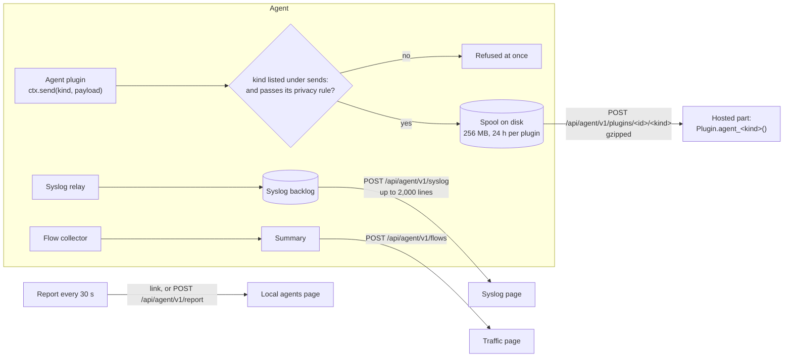
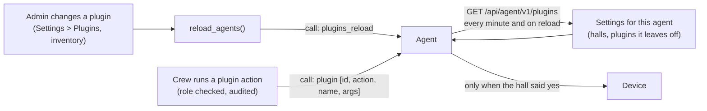
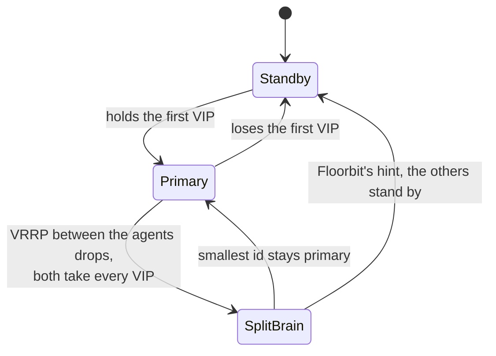
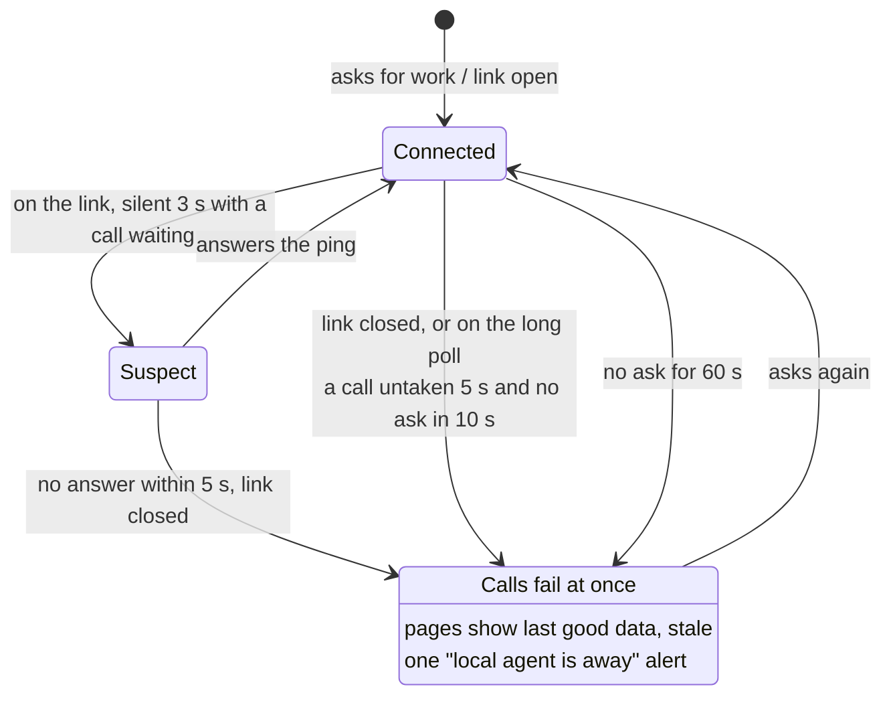

# Agent communication

How Floorbit and the [local agent](agent.md) talk. The agent always opens the connection, out to
Floorbit over HTTPS; nothing in the hall has to be reachable from outside. The rules and every
endpoint are in [agent.md](agent.md#the-protocol) and [agent-plugins.md](agent-plugins.md#how-it-travels).

Code: [`floorbit/agent_link.py`](../floorbit/agent_link.py) and
[`floorbit/blueprints/agent.py`](../floorbit/blueprints/agent.py) on the Floorbit side; the agent
in [bitsandbricks-ch/floorbit-agent](https://github.com/bitsandbricks-ch/floorbit-agent)
(`floorbit_agent/__init__.py`, `plugin_host.py`, `spool.py`).

## Starting up

```mermaid
sequenceDiagram
  autonumber
  participant A as Agent
  participant F as Floorbit
  A->>F: GET /api/agent/v1/hello<br/>Floorbit-Agent-Key, -Signature, -Version, -Protocol
  opt no key pinned yet, or its client cert ends within 30 days
    A->>F: POST /api/agent/v1/identity (CSR of its own key)
    F-->>A: client certificate; the key is pinned
  end
  alt key wrong or revoked
    F-->>A: 401
    Note over A: stops with exit code 1<br/>(enrol again)
  else protocol not spoken here
    F-->>A: 426 + the protocol Floorbit speaks
    Note over A: stops with exit code 1<br/>(update one side)
  else ok
    F-->>A: name, server_version, encodings,<br/>protocol, protocols, link
  end
  A->>F: GET /api/agent/v1/plugins (ETag)
  F-->>A: plugin settings (secrets too, over TLS),<br/>bundles to fetch
  A->>A: start its plugins (LibreNMS, Telemetry,<br/>syslog, front door, ...)
  alt protocols lists 2
    A->>F: GET /api/agent/v2/link (WebSocket upgrade)
    F-->>A: {"type": "hello", "name", "protocol"}
  else WebSocket blocked on the way
    Note over A: falls back to the long poll,<br/>tries the link again later
  end
```

When Floorbit can't be reached the agent waits 1 s, then 2, 4 and so on up to a minute between
tries.

## Calls: Floorbit asks, the agent answers

A page, a background loop or a crew action needs something from the hall (which switches are up,
which port an IP is on, a port bounce). Only the methods in `agent_link.METHODS` can be asked.



With several Floorbit pods (`FLOORBIT_CLUSTER=redis`), a call made on a pod that doesn't hold the
agent's link goes to the pod that does through a Redis list, and the answer comes back the same way
([kubernetes.md](kubernetes.md)).

## Sends: the agent pushes

What the agent collects by itself goes the other way, as HTTPS posts, never over the link.



A send the uplink couldn't take waits in the spool, so an outage loses nothing within those limits.

## Settings and actions



## Two agents in one hall

Agents for the same halls share virtual IPs with VRRP. Only the **primary** polls devices and logs in
to them; both answer Floorbit's calls and take syslog, NetFlow and traps sent to their address.



## When the agent goes away



Calls that were with the agent when it went fail with "went away before it answered; it may have
run", so a port action is looked at before it is tried again.
