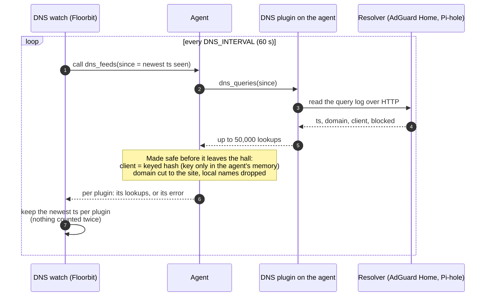
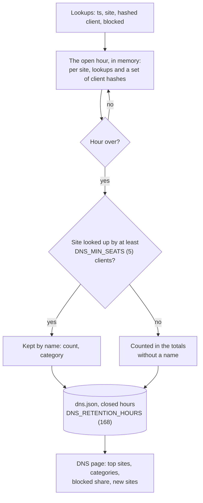

# DNS

From the event resolver's query log to the [DNS page](dns.md), and what never leaves the hall.

Code: [`floorbit/dns.py`](../floorbit/dns.py) (the counting), `dns_feeds` in the agent
(`floorbit_agent/__init__.py`), the Marketplace plugins for
[AdGuard Home](https://github.com/bitsandbricks-ch/floorbit-plugin-adguard-home) and
[Pi-hole](https://github.com/bitsandbricks-ch/floorbit-plugin-pihole).

What Floorbit does with the lookups:

When the hour closes, only counts stay: the client hashes are dropped. Nothing is per seat or per
person ([dns.md](dns.md#privacy)).

Resolver health is a separate path: the [Services page](how-servers.md) asks each resolver for a
name every 30 s and shows how long it took.
