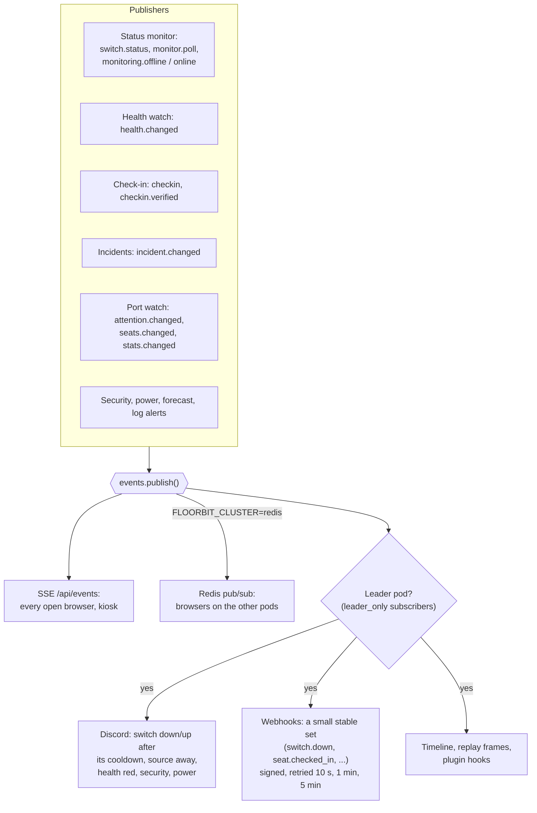
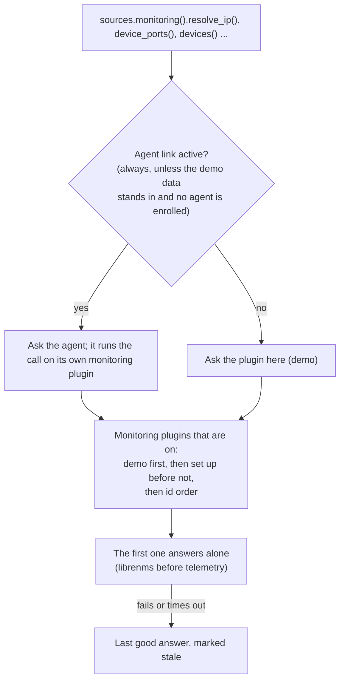
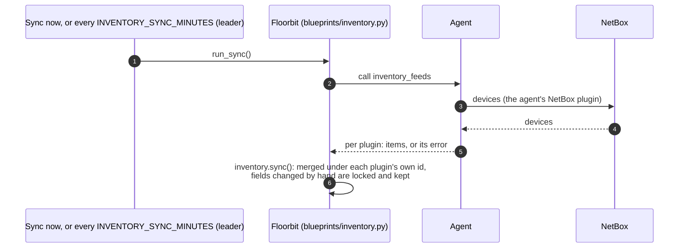
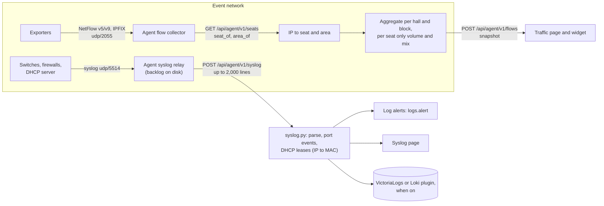
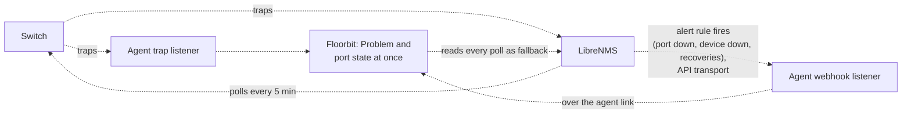

# Integrations

How Floorbit's parts tell each other and the outside world what happened, and how the outside
sources (NetBox, LibreNMS, syslog, NetFlow) come in. Settings and payloads are in
[integrations.md](integrations.md), [api.md](api.md#webhooks), [syslog.md](syslog.md) and
[flows.md](flows.md).

## The event bus

Code: [`integrations/events.py`](../integrations/events.py), [`floorbit/cluster.py`](../floorbit/cluster.py),
[`floorbit/webhooks.py`](../floorbit/webhooks.py), [`integrations/discord.py`](../integrations/discord.py).
Anything in the app can `publish(type, data)`; everything that reacts subscribes.

Python subscribers run on the pod where the event was published. Ones that post, send or write
are `leader_only`: every pod runs the background loops, and the alert should go out once. Events
caused by a request act on the pod that took it. With Redis away, every pod acts as the leader: a
duplicate alert is better than none. Webhook payloads carry no nicks, IPs or MACs.

## Which monitoring source answers

Code: `registry.monitoring_source()` in [`floorbit/plugins/__init__.py`](../floorbit/plugins/__init__.py),
[`floorbit/sources/__init__.py`](../floorbit/sources/__init__.py).

Only one source answers at a time. With LibreNMS and Telemetry both on and set up, LibreNMS
answers every lookup ([telemetry.md](telemetry.md#set-it-up), step 4). Picking the source per kind
of data is planned ([#945](https://github.com/bitsandbricks-ch/floorbit/issues/945)).

## NetBox and the inventory

The Cables page's **Import** asks `cable_feeds` the same way: imported cables replace the last
import, and a crew cable on the same switch port wins ([cables.md](cables.md)).

## Syslog and NetFlow from the hall

## Planned: LibreNMS alerts as webhooks

**Planned, not built.** From section 5 of the plan "IP/MAC lookups, table walks and telemetry
logging" (2026-11-19), issue [#951](https://github.com/bitsandbricks-ch/floorbit/issues/951). When LibreNMS runs, it becomes the source for port and device
states, and Telemetry stops its own 30 s port polling. LibreNMS polls every 5 minutes, so its alerts
are pushed instead of waited for.

The LibreNMS plugin settings would show the alert rules and transport to paste into LibreNMS, with
a **Send test** check. If the webhook goes quiet, the normal read still runs, so nothing is lost,
only slower.
