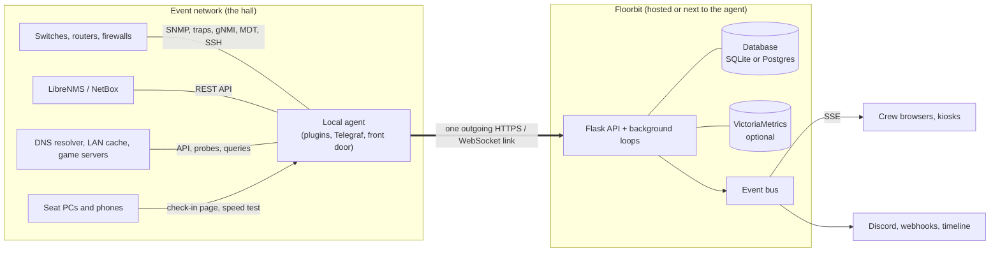

# How it works

These pages draw how data moves through Floorbit, one flow per page. They describe what the code
does today. Where a flow is planned but not built yet, the diagram says **planned** and is drawn
with dashed lines, so nobody mistakes it for current behaviour.

| Page | What it draws |
| --- | --- |
| [Seats, ports and MACs](how-seat-mapping.md) | How a seat gets its switch port, IP, MAC and nick: the seat mapping, PIN check-in, the crew's seat walk |
| [Switches, blocks and rows](how-switch-placement.md) | How a switch is tied to the seats it serves, today and as planned |
| [Agent communication](how-agent.md) | How Floorbit and the local agent talk: enrolment, the link, calls, sends, settings, failover |
| [Telemetry processing](how-telemetry.md) | From a switch's counters to the floor plan and the history |
| [Metrics](how-metrics.md) | Where numbers are kept and who can read them |
| [States](how-states.md) | The state machines: switches, seats, check-ins, agents, services, incidents |
| [Onboarding](how-onboarding.md) | From a fresh install to a hall that reports |
| [DNS](how-dns.md) | From the resolver's query log to the DNS page, and what never leaves the hall |
| [Servers and services](how-servers.md) | Internet lines, resolvers, sites, game servers and the health wall |
| [Integrations](how-integrations.md) | The event bus and everything it feeds, NetBox, LibreNMS, syslog and NetFlow |

## The whole picture

The [local agent](agent.md) is the only way Floorbit reaches the event network, hosted or
self-hosted. Everything on the left of the dashed line lives in the hall.

The code behind each box is in [architecture.md](architecture.md).
