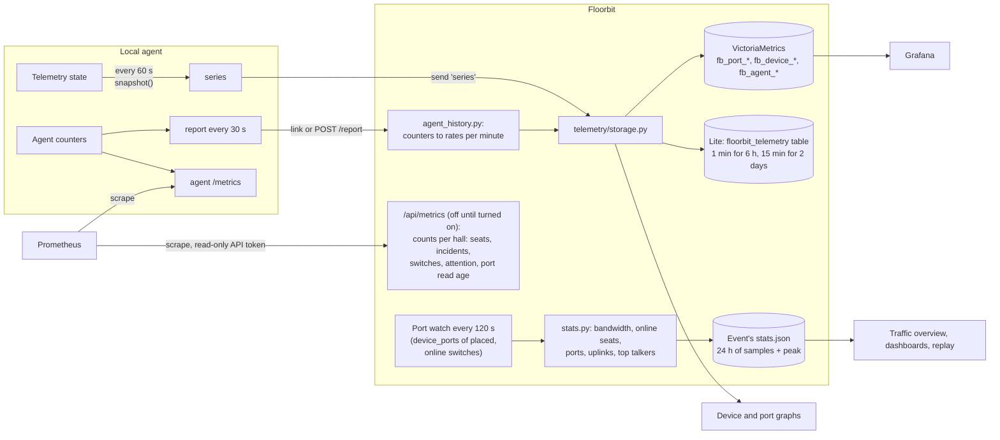

# Metrics

Where Floorbit's numbers come from, where they are kept, and who reads them. There are four kinds,
each with its own path.

| Kind | Made by | Kept in | Read by |
| --- | --- | --- | --- |
| Device and port series | Telemetry on the agent ([how-telemetry.md](how-telemetry.md)) | Lite database or VictoriaMetrics | Device graphs, `/api/telemetry/series`, Grafana |
| Hall stats | The port watch on Floorbit | Memory + the event's `stats.json` document | Traffic overview, dashboards, replay |
| Floorbit's own counts | `/api/metrics` at scrape time | Nowhere: worked out per scrape | A NOC's Prometheus and Grafana |
| Agent numbers | The agent's report and `/metrics` | Telemetry storage (`agent:<id>`) | The agent's Graphs tab, Prometheus |

Rules that hold on every path:

- **Aggregate only** where people could be named: `/api/metrics` is per hall at most, with no seat,
  nick, address or switch name ([metrics.md](metrics.md)). Telemetry series are per device and port;
  MAC tables and ARP are never stored as series.
- **Redis is not used** for any of it.
- **Lite or VictoriaMetrics, not both.** With `FLOORBIT_VICTORIAMETRICS_URL` set, the series go there
  and the lite table isn't written.
