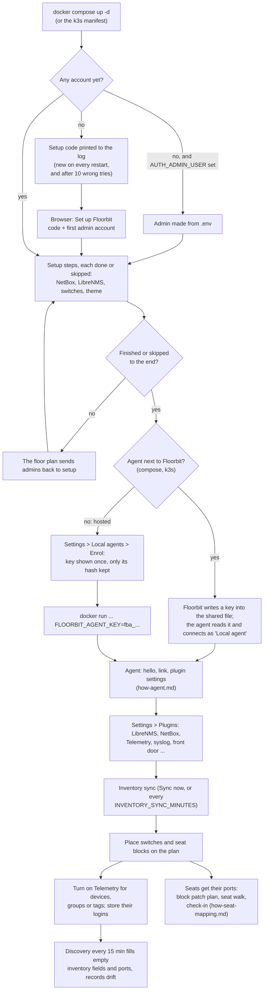
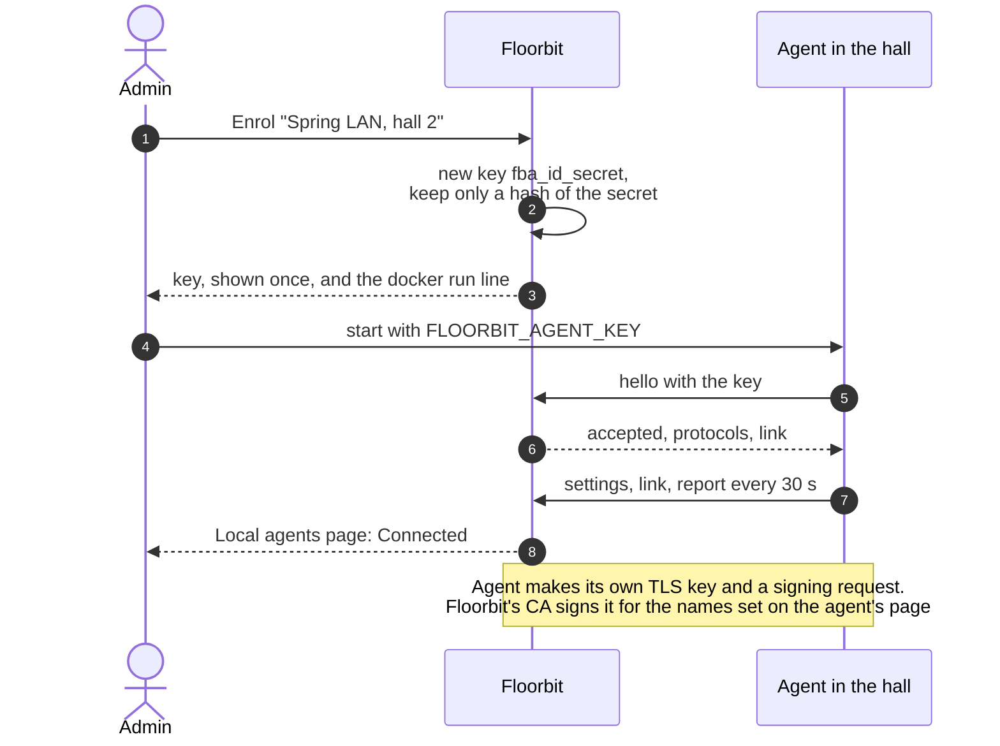
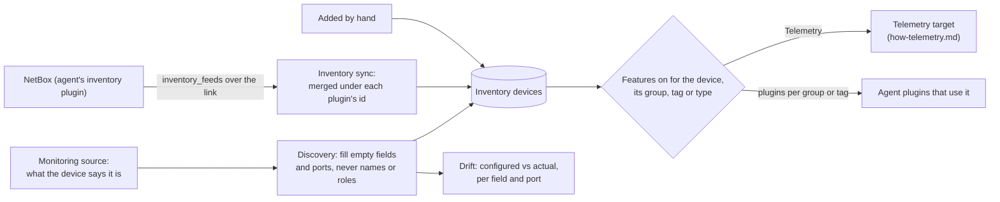

# Onboarding

From a fresh install to a hall that reports. The steps for people are in [install.md](install.md)
and [agent.md](agent.md#enrolling-an-agent); this page draws what happens underneath.

Code: [`floorbit/setup.py`](../floorbit/setup.py) (first-run setup),
[`floorbit/agent_link.py`](../floorbit/agent_link.py) (enrolment),
[`floorbit/blueprints/inventory.py`](../floorbit/blueprints/inventory.py) (syncs),
[`floorbit/inventory_discovery.py`](../floorbit/inventory_discovery.py) (discovery).

## The whole way

An install that already had switches, blocks or settings before the setup existed counts as set up.

## Enrolling a hosted agent

## A device joins the inventory

