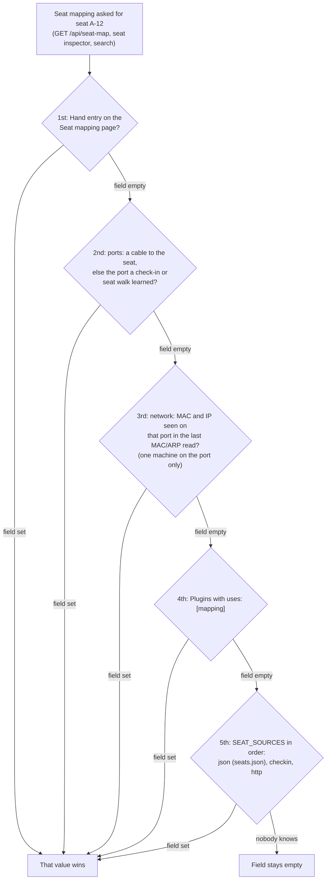
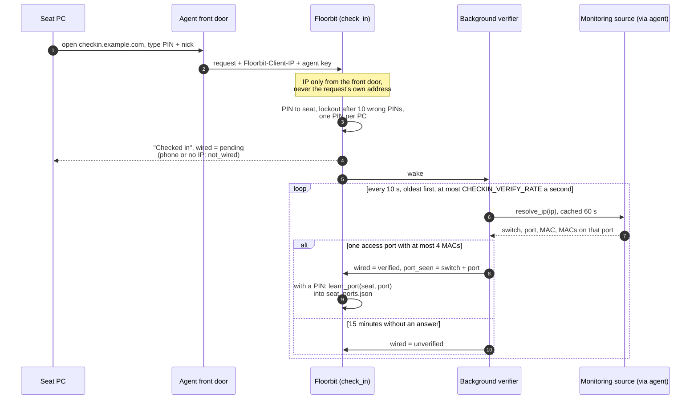
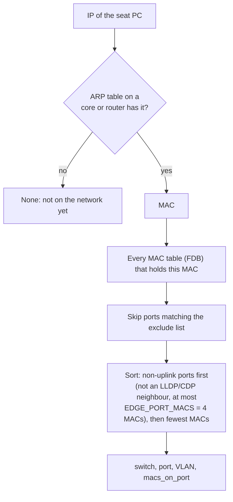
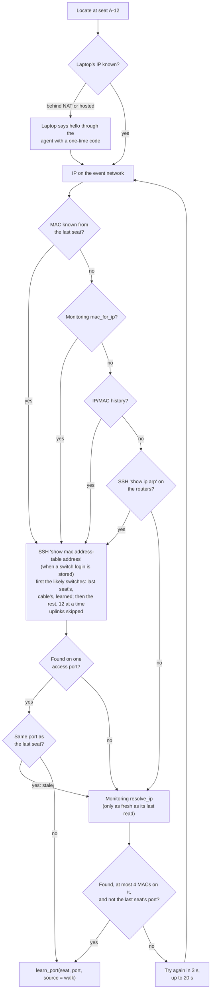
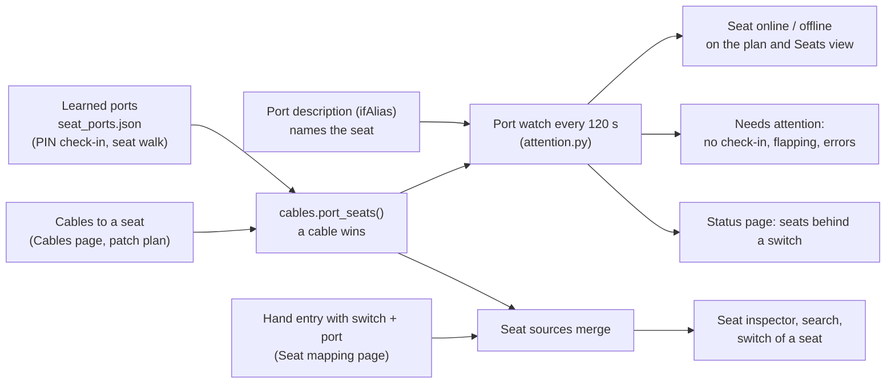
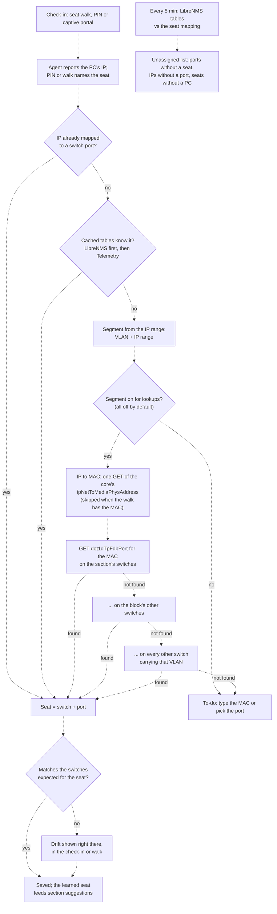

# Seats, ports and MACs

How a seat gets its switch port, and from that its MAC, IP and nick. The rules are in
[seat-mapping.md](seat-mapping.md); this page draws them. The key is always **switch + port**: an IP
or MAC is only the way to find the port.

Code: [`floorbit/seatmap.py`](../floorbit/seatmap.py) (hand entries),
[`integrations/seat_sources.py`](../integrations/seat_sources.py) (the merge),
[`integrations/checkin.py`](../integrations/checkin.py) (PIN check-in and the background lookup),
[`floorbit/seat_walk.py`](../floorbit/seat_walk.py) (the crew's walk-through),
[`floorbit/cables.py`](../floorbit/cables.py) (`port_seats`).

## Where a seat's fields come from

Every seat source is asked, and the first one with a value for a field wins, field by field. A hand
entry that leaves a field empty lets the next source fill it.

## PIN check-in

The attendee types the PIN from the seat card and a nick on the seat PC. The page answers at once;
the port is looked up in the background.

## How the monitoring source finds the port

`resolve_ip` is the same call for check-in, the captive portal, search and the seat walk's second
step. Which plugin answers it is picked by `registry.monitoring_source()`: the first monitoring
plugin that is on and set up, in id order, so **LibreNMS answers when it is set up, else Telemetry**
([how-integrations.md](how-integrations.md#which-monitoring-source-answers)).

Every switch between the core and the seat learns the MAC too, on its uplink, so the port with the
fewest MACs is the seat's. One rule says what a seat's port is: at most 4 MACs (one PC and its
VMs), `floorbit/edge_ports.py`. Check-in only counts a port as `verified` when it passes, the seat
walk refuses one that doesn't, and Telemetry, the IP/MAC history and the planned lookups treat a
port above it as an uplink.

## Crew seat walk

The crew plugs a laptop into each seat's port and presses **Locate**. Freshest answer first,
because every seat counts. Each try runs for up to 20 seconds, retrying every 3 seconds.

The monitoring step refuses a port with more than 4 MACs: when the access switch hasn't seen the
laptop (not polled, or its entry aged out), only an uplink still has the MAC, and that is never the
seat's port. The walk keeps the MAC and tries again.

## Who reads the seat's port

A learned or cabled port is what the rest of Floorbit uses to say "this port is that seat".

Hand entries reach the seat sources, but not `cables.port_seats()`, so the port watch does not see
them: a seat whose port was only typed in by hand stays `unknown` on the plan ([#953](https://github.com/bitsandbricks-ch/floorbit/issues/953)).

## Planned: check-in driven lookups

**Planned, not built.** From the plan "IP/MAC lookups, table walks and telemetry logging"
(2026-11-19), issues [#945](https://github.com/bitsandbricks-ch/floorbit/issues/945) (source per kind of data), [#946](https://github.com/bitsandbricks-ch/floorbit/issues/946) (segments and an SNMP
client on the agent), [#947](https://github.com/bitsandbricks-ch/floorbit/issues/947) (this lookup) and [#949](https://github.com/bitsandbricks-ch/floorbit/issues/949) (the unassigned list). Lookups would ask the switches directly with SNMP GETs (pysnmp on the agent), narrowed
by the seat's section and block ([how-switch-placement.md](how-switch-placement.md#planned-switches-serve-blocks-and-sections)),
instead of waiting for the next table read.

Uplinks are skipped as today (trunk ports, LLDP/CDP neighbours, more than 4 MACs). A lookup is about
1 + 2 small GETs per switch asked, deduplicated per IP or MAC for 60 seconds.
