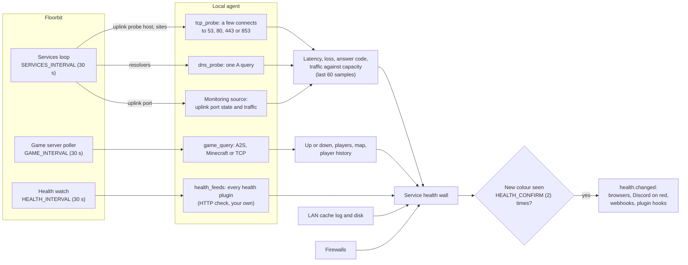
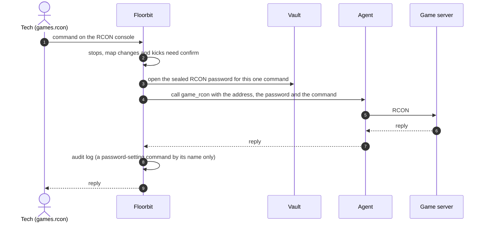

# Servers and services

How Floorbit watches what the players need besides the switches: internet lines, DNS resolvers,
internet sites, the LAN cache, game servers, and everything a health plugin reports. Every probe
runs on the agent, from the event network.

Code: [`floorbit/services.py`](../floorbit/services.py), [`floorbit/probes.py`](../floorbit/probes.py),
[`floorbit/game_servers.py`](../floorbit/game_servers.py), [`floorbit/game_query.py`](../floorbit/game_query.py),
[`floorbit/health.py`](../floorbit/health.py).

## Every 30 seconds

A probe only connects to 53, 80, 443 or 853 and sends nothing, or one DNS query, so it can't be used
to talk to a service. Link-local addresses are never probed, and `PROBE_NETS` (`FLOORBIT_AGENT_PROBE_NETS`
on the agent) narrows where probes may go.

## RCON

