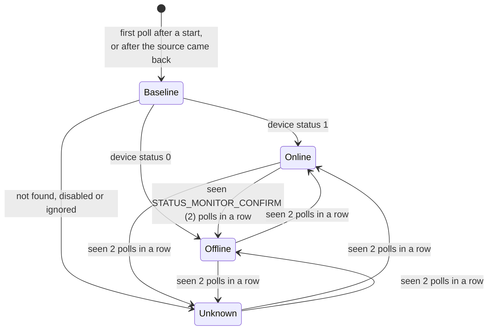
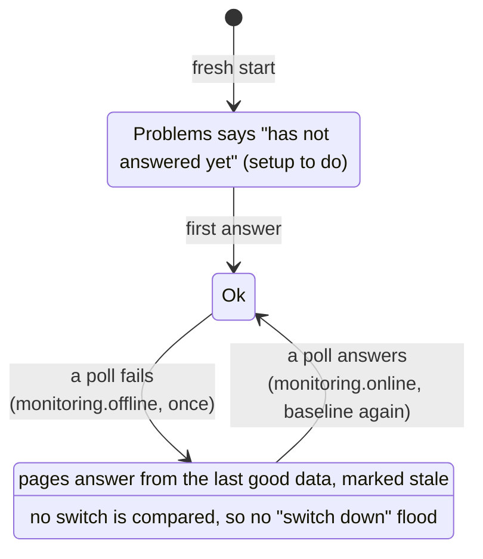
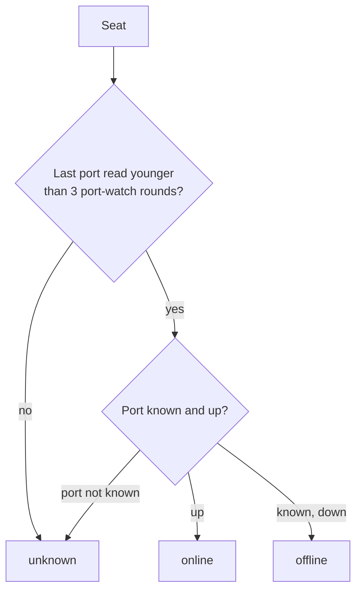
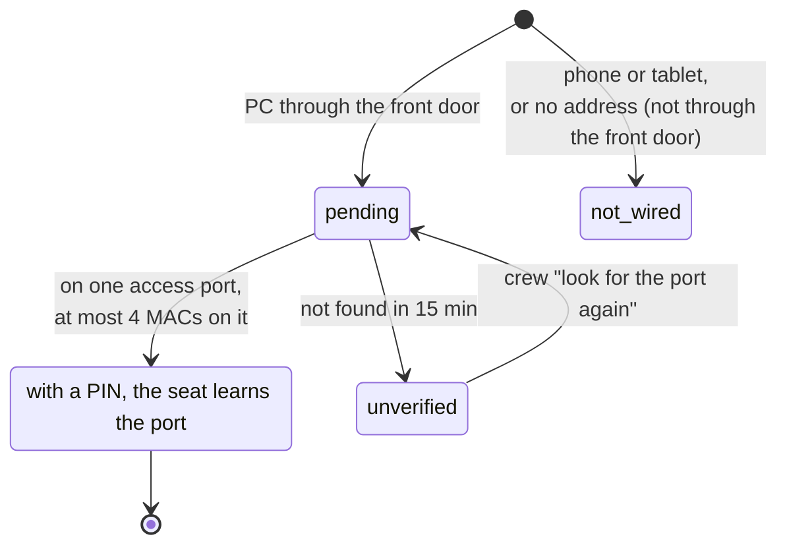
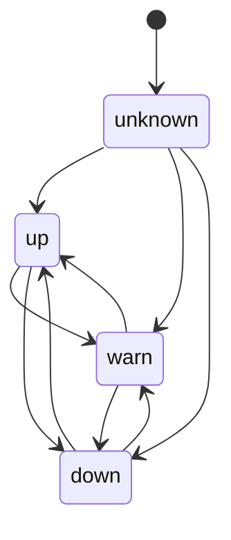
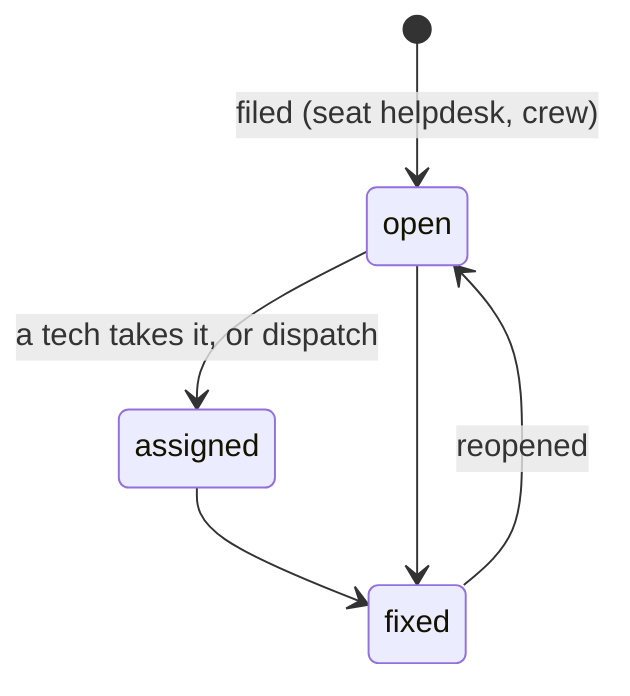
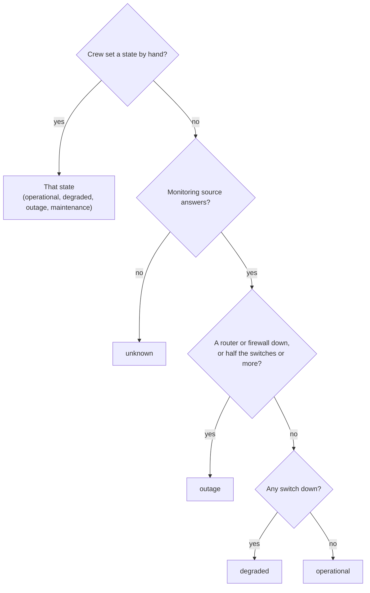
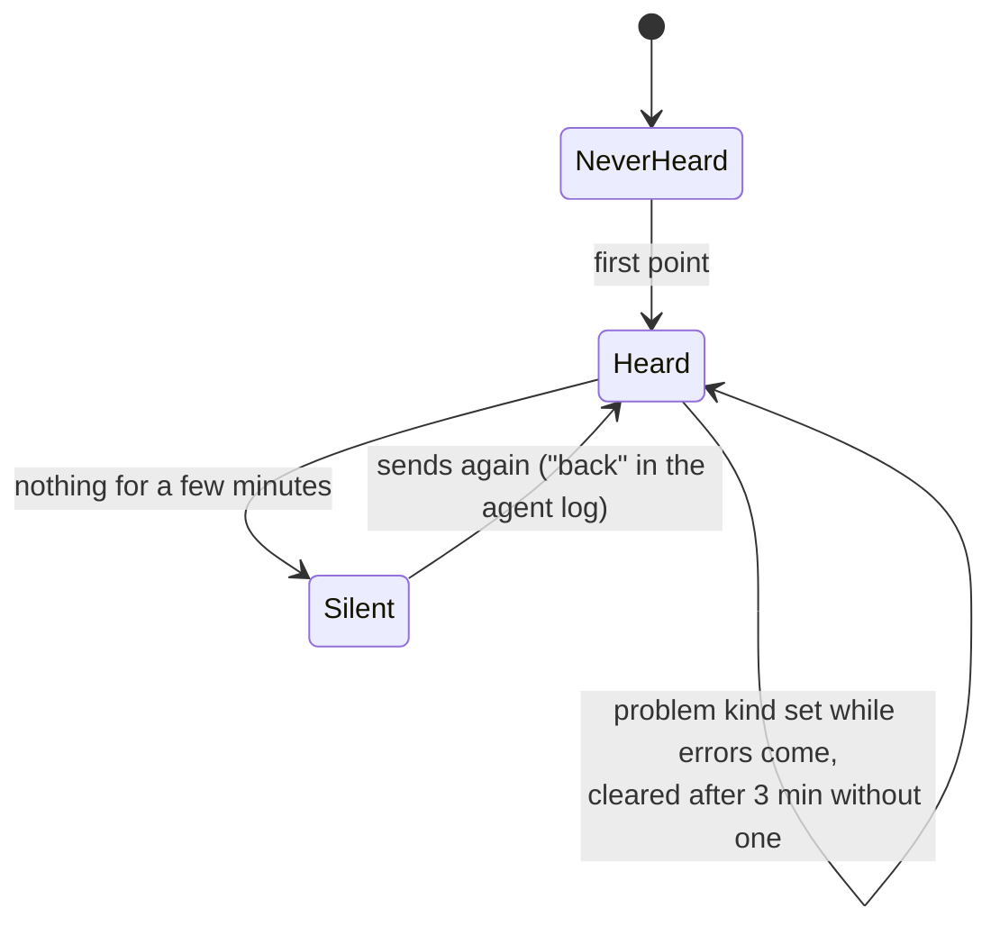

# States

The state machines behind the colours on the plan and the pages. The agent's own states (connected,
away, primary, standby) are on [how-agent.md](how-agent.md).

## Switch status

Code: [`integrations/monitor.py`](../integrations/monitor.py). Every `STATUS_MONITOR_INTERVAL`
seconds (60) it asks the monitoring source for every device in one request and matches them to the
switches on the plan.

The baseline poll publishes nothing, so a restart doesn't page anyone. Each confirmed change
publishes `switch.status` ([how-integrations.md](how-integrations.md)).

## The monitoring source

Code: [`floorbit/sources/__init__.py`](../floorbit/sources/__init__.py).

On a hosted Floorbit the source is the agent, and the alert says "The local agent is away".

## Seat on the plan

Code: [`floorbit/seat_view.py`](../floorbit/seat_view.py). The port watch reads every port of the
placed, online switches every 120 s; the seat's port comes from a cable, a learned port or the port
description ([how-seat-mapping.md](how-seat-mapping.md#who-reads-the-seats-port)).

Flags on top: `checked_in`, `taken` (the mapping has a player), `problems` (open incidents and port
trouble), `match` and `note`.

## Check-in port lookup

Code: [`integrations/checkin.py`](../integrations/checkin.py) (`wired`).

## Service health

Code: [`floorbit/health.py`](../floorbit/health.py). Every `HEALTH_INTERVAL` (30 s) each health plugin
is asked; a new status counts once seen `HEALTH_CONFIRM` (2) polls in a row, after a baseline poll
that publishes nothing. Then `health.changed` goes out.

## Incidents

Code: [`floorbit/incidents.py`](../floorbit/incidents.py). Statuses are `open`, `assigned` and
`fixed`; the crew can set any of them. With automatic dispatch on, a new incident goes to the
nearest free tech ([dispatch.md](dispatch.md)).

## Public status page

Code: [`floorbit/status_page.py`](../floorbit/status_page.py).

## A telemetry device

