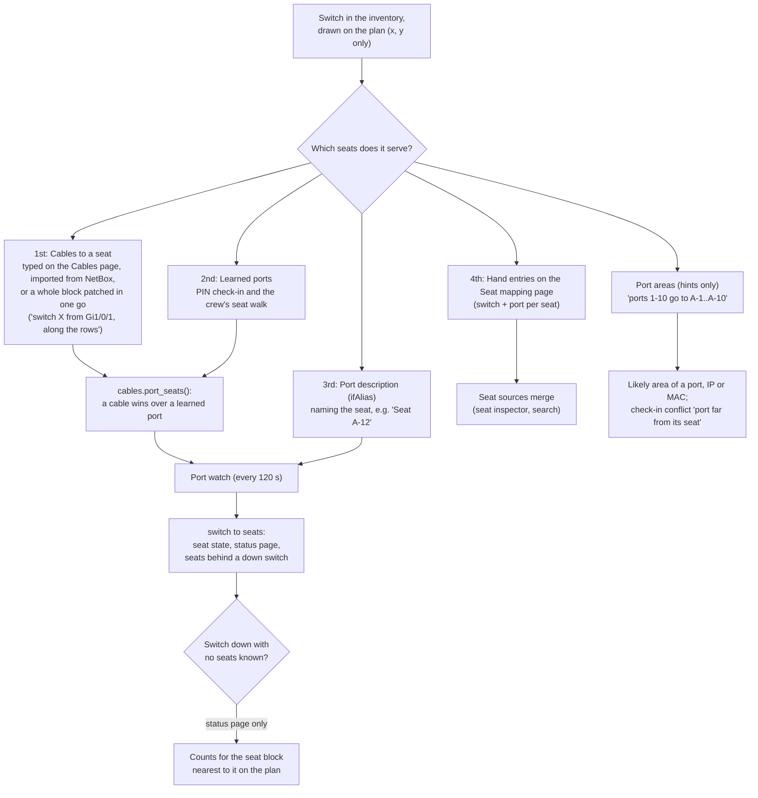
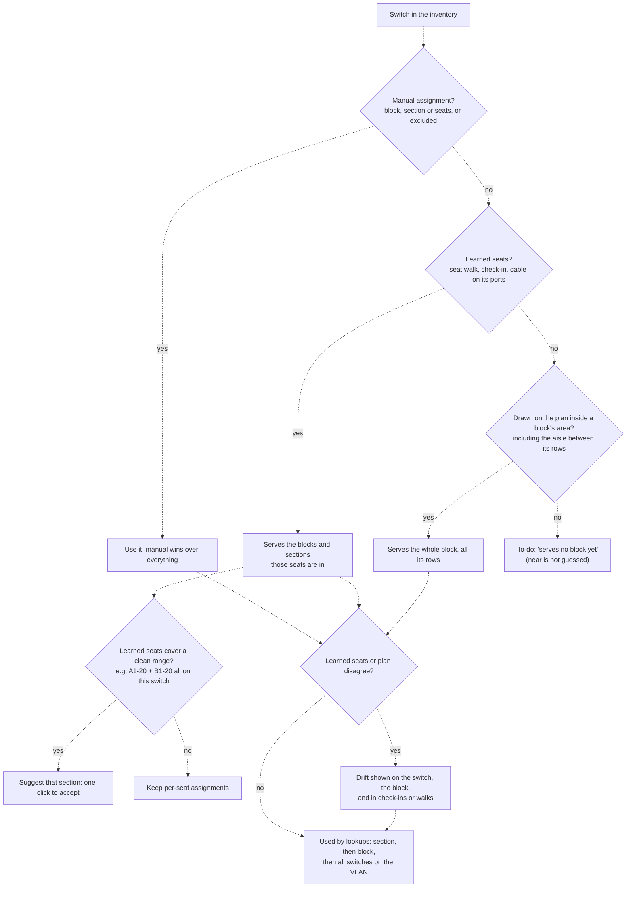

# Switches, blocks and rows

How Floorbit knows which seats a switch serves. A **seat block** is a group of seats in rows and
columns ([seats.md](seats.md)); its seats are named from the block's rows (`A-1`, `A-2`, …, `B-1`).

## Today: a switch serves the seats whose ports it has

There is no field that says "this switch serves block A". Drawing a switch on the plan only gives it
a position. Floorbit learns a switch's seats **port by port**, from these sources, strongest first:

What that means in practice:

- **A block patched in one go** ([cables.md](cables.md)) is the nearest thing to "this switch serves
  this block": it makes one cable per seat, so every seat has its port before doors open.
- **Port areas** ([`floorbit/port_areas.py`](../floorbit/port_areas.py)) say "ports 11-20 of
  `sw-a-01` go to `A-11..A-20`". They never name a seat's exact port; they narrow where to look and
  flag a check-in that learned a port far from its seat.
- **The seat walk's likely switches** ([how-seat-mapping.md](how-seat-mapping.md#crew-seat-walk))
  are the last seat's switch, the seat's cable and its learned port: rows are mostly on one switch.
- A switch with no cabled, learned or described port serves no seat. Its position on the plan is
  used in one place only: the [status page](status-page.md) counts a down switch with no known seats
  for the seat block nearest to it ([`floorbit/status_page.py`](../floorbit/status_page.py)). The
  seats each switch served are remembered in memory from the last port read, so they are gone after
  a restart.

## Planned: switches serve blocks and sections

**Planned, not built.** From section 4 of the plan "IP/MAC lookups, table walks and telemetry
logging" (2026-11-19), issue [#948](https://github.com/bitsandbricks-ch/floorbit/issues/948). A switch gets a block, a section or single
seats, so lookups can ask the right switches first.

- A **block** holds one or more rows. A **section** is a seat range across the block's rows, for
  example `A1-A20 + B1-B20`. Sections are optional and off until someone draws one.
- A switch can serve several rows and several blocks.

**Drift** is shown rather than picked silently: a seat learned on `access-b2` while its row is
pinned to `access-b1`, or a switch drawn in row C that serves only row D seats.

Under the plan a switch near a block but outside it is **not** guessed, unlike the status page's
nearest-block rule today.

**Seats behind a down switch.** Today the status page lists the blocks and rows a down switch hits,
and the seat inspector names the down switch serving a seat. Planned on top ([#950](https://github.com/bitsandbricks-ch/floorbit/issues/950)): Problems lists every
seat behind a down switch or a down uplink with a count ("access-b1 down, 24 seats affected"),
switches behind a down uplink included, and turns them red on the plan; seat names only, never who
sits there.
