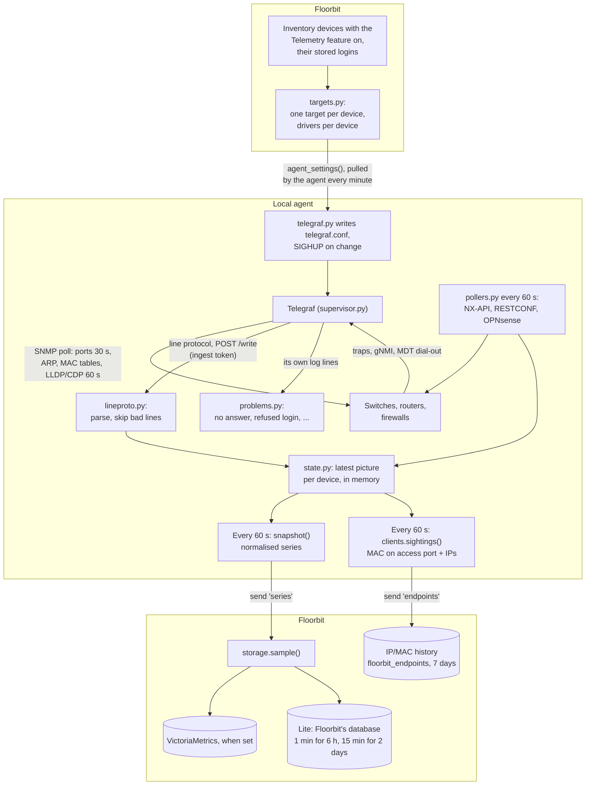
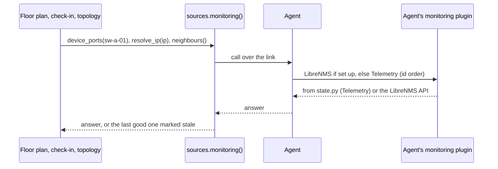
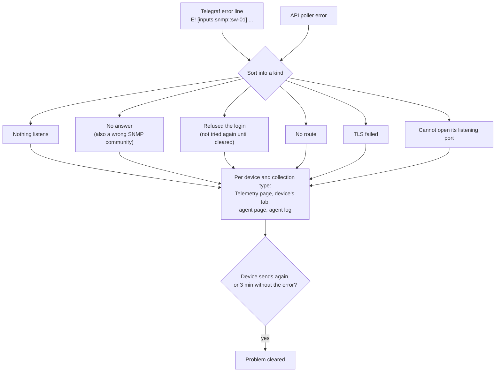

# Telemetry processing

From a switch's counters to the floor plan and the history. Setup and every option are in
[telemetry.md](telemetry.md); this page draws the path. The local agent is the collector: it runs
Telegraf, keeps the live picture and sends Floorbit only the normalised series and the sightings.

Code: [`floorbit/telemetry/`](../floorbit/telemetry/) (targets, Telegraf config, line protocol,
state, storage, problems) and the Telemetry plugin
[`floorbit/builtin_plugins/telemetry/`](../floorbit/builtin_plugins/telemetry/) (`agent.py` runs on
the agent, `plugin.py` on Floorbit).

## The path of a point

MAC tables, ARP and neighbours stay in the agent's memory: they name the people at the seats, so
they are never stored as series ([telemetry.md](telemetry.md#privacy)). What leaves the agent is
the normalised numbers and the sightings for the [IP/MAC history](endpoints.md). Raw points don't
reach VictoriaMetrics on this path ([#955](https://github.com/bitsandbricks-ch/floorbit/issues/955)).

## Reading the live picture

Pages that need the live picture don't read storage. They ask the monitoring source, which reaches
the agent's in-memory state through the link.

## When a device sends nothing

## Two agents

Both agents get the targets; only the primary polls and logs in. A device can be pinned to one
agent ("one agent per device"), which then polls it whatever VRRP says
([telemetry.md](telemetry.md#two-agents-for-the-same-devices)).
