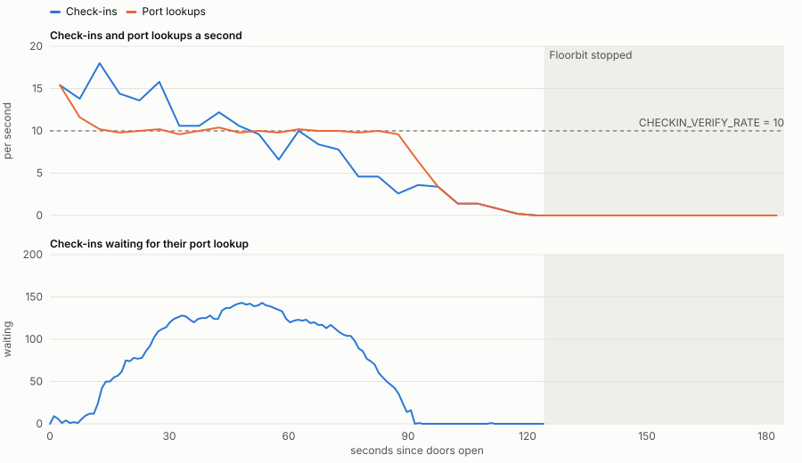
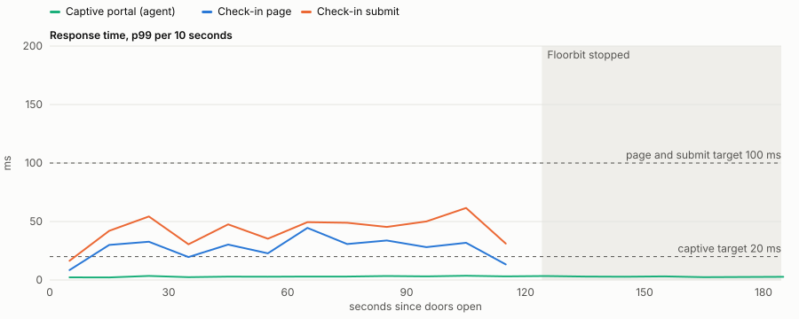

# Sizing for a large event

How much of Floorbit's own work grows with the number of seats, measured with
`scripts/load_test.py` (issue #473). The script builds a hall of fake switches in memory, with a PC
on every seat port, and times what Floorbit does with it. Nothing talks to LibreNMS, NetBox or
Redis, so the numbers are Floorbit's share only.

```sh
python scripts/load_test.py --seats 4000 --database sqlite --fdb-ms 1000
```

## Measured

4000 seats on 84 access switches (48 seat ports each). LibreNMS was given a pretend 1 second per MAC
table read. This ran in a 4-CPU container with Python 3.13:

| What | Files | SQLite |
| --- | --- | --- |
| Unmatched clients: read every seat switch's MAC table | 21.1 s | 21.1 s |
| Patch plan check (ports up against the cables) | 0.01 s | 0.01 s |
| Every seat checks in once, one after the other | 37.5 s (9.4 ms each) | 43.3 s (10.8 ms each) |
| Read the whole check-in history back | 0.01 s | 0.01 s |

Postgres wasn't measured. The script takes `--database files` or `sqlite`.

## What it means

- **MAC tables are the slow part, and LibreNMS sets the pace.** Floorbit reads four switches side
  by side (`WORKERS` in `floorbit/port_clients.py`), at most every two minutes, in the background.
  The page shows the last read. Floorbit's own work on 4000 seats takes under a tenth of a second.
  The rest is waiting on LibreNMS, which costs about (switches ÷ 4) × its time per MAC table.
- **The patch plan check is free.** It reads what the port watch already polled, so the seat count
  doesn't add LibreNMS calls.
- **Check-in keeps up with doors opening.** One check-in takes about 10 ms at 4000 seats, so even
  4000 people arriving in the same few minutes are a handful of seconds of work. Check-ins
  queue on one lock; none is lost.
- **Bulk reads only.** ARP is read once per seat network (a /24), and MAC tables once per switch.
  There is never one LibreNMS call per client.

## Doors-open

What happens when the doors open, measured with `scripts/load_checkin.py`: a real Floorbit under
gunicorn, set up like the Docker image (1 worker, 64 threads), and a real agent answering the
Captive Portal API, both on one machine. LibreNMS is a fake that takes 50 ms per port lookup.

```sh
python scripts/load_checkin.py --agent-src ../floorbit-agent
```

1000 players check in within two minutes, most of them early. Each loads the check-in page and its
info, then checks in from its own IP. Meanwhile 4000 devices ask the agent's captive portal every 30
seconds. Once the port lookups have caught up, Floorbit is stopped and the devices go on asking for
another minute. This ran in a 4-CPU container with Python 3.13 (load generator included):

| What | Requests | Failed | p50 | p99 | Target (p99) |
| --- | --- | --- | --- | --- | --- |
| Captive portal (agent), Floorbit up | 16544 | 0 | 1.1 ms | 3.1 ms | < 20 ms |
| Captive portal (agent), Floorbit stopped | 7756 | 0 | 1.1 ms | 2.8 ms | < 20 ms |
| Check-in page and its info | 2000 | 0 | 4.5 ms | 30.7 ms | < 100 ms |
| Check-in submit | 1000 | 0 | 14.4 ms | 47.5 ms | < 100 ms |





- **Check-in never waits for LibreNMS.** The submit answers at once with `pending`; the port lookup
  runs in the background, oldest first, at most **Port lookups per second** (`CHECKIN_VERIFY_RATE`,
  10). Above that the queue grows (143 at its peak here) and drains at that rate; it was empty
  again before the last players arrived. Every check-in got its lookup, 1000 in all, and not one more.
- **The page's seat hint doesn't either.** It shows what is already known; a miss joins the same
  queue when there is room.
- **The captive portal is the agent's job.** It answers from the list it last fetched, so it stays
  at a few milliseconds whatever Floorbit is doing, and with Floorbit stopped it went on answering:
  checked-in PCs "done", everyone else "sign in", with no wrong answer in a sample of 200.
- **Raise the rate** if your LibreNMS keeps up and you want ports learned faster, lower it if
  LibreNMS slows down at doors-open. Lookups run one at a time, so a lookup slower than
  1 ÷ rate seconds sets the pace instead.

Run the script again after changing check-in or the seat mapping, and update this page when the
numbers move.

## More than one worker

The image runs one gunicorn worker with 64 threads. Python runs one thread at a time per process, so
when many tabs ask at once (doors open, a dashboard wall reloading) their requests queue behind each
other. Measured with crew tabs that each load a page's reads at once (sign-in check, pages, problems,
a dashboard batch, plan, inventory, seat map, stats, incidents: 12 requests), demo data, Postgres and
Valkey, in a 4-CPU container with the load generator on the same machine:

| Tabs at once | 1 worker: p50 / p95 | 4 workers: p50 / p95 |
| --- | --- | --- |
| 1 | 28 / 77 ms | 11 / 32 ms |
| 5 | 121 / 484 ms | 31 / 168 ms |
| 15 | 184 / 1482 ms | 92 / 317 ms |

Several workers in one container need what [several pods](kubernetes.md#more-than-one-pod) need,
except the shared volume, which they already have:

- `FLOORBIT_CLUSTER=valkey` and `REDIS_HOST`, so live updates and agent calls reach every worker and
  only one sends alerts. Without it Floorbit logs a warning at start.
- **Not yet:** the [switch terminal](terminal.md) keeps its sessions in the worker that opened them,
  so with several workers a terminal can lose its output. Stay on one worker if the crew uses it.

To try it: `GUNICORN_CMD_ARGS=--workers 2` (or up to the number of CPUs) in `.env` or the pod's
environment. `GUNICORN_CMD_ARGS=--threads 200` raises the threads the same way.
